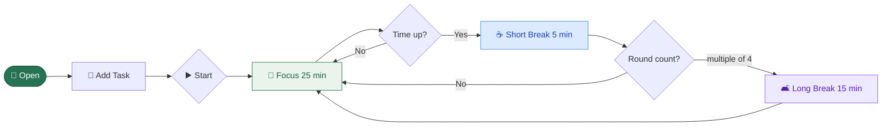
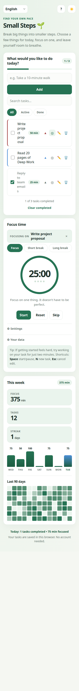
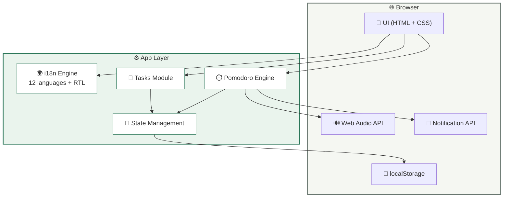
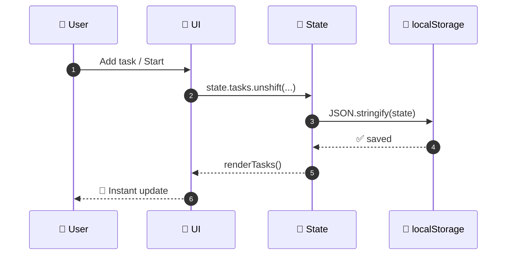
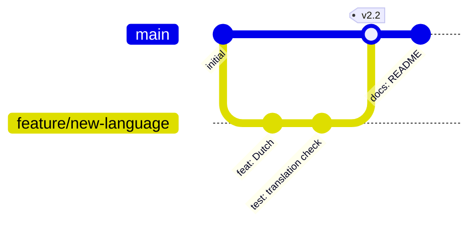

# 🌱 Small Steps

<div align="center">

**Task list + Pomodoro timer.**  
Multi-file, zero dependencies, 12 languages, works offline.

<br/>

[](../../releases)
[](#-pwa-installation)
[](#-languages)
[](./LICENSE)
[](#-project-structure)

<br/>

[🚀 Get Started](#-usage) · [✨ Features](#-features) · [🌍 Languages](#-languages) · [🛠️ Customization](#️-customization)

</div>

---

## 📖 Table of Contents

[Features](#-features) · [Usage](#-usage) · [Languages](#-languages) · [Architecture](#-architecture) · [Project Structure](#-project-structure) · [Customization](#️-customization) · [Data Storage](#-data-storage) · [Browser Support](#-browser-support) · [FAQ](#-faq) · [Contributing](#-contributing) · [License](#-license)

---

## ✨ Features

<table>
<tr>
<td width="50%" valign="top">

### 📝 Tasks
- ➕ **Quick add** — press `Enter`
- ✅ **Complete / undo** — one click
- ✏️ **Edit** — double-click · `Enter` to save · `Esc` to cancel
- 🗑️ **Delete + Undo** — toast notification
- 🔎 **Filters** — All · Active · Done
- 📊 **Progress bar** — live percentage
- 🧹 **Bulk clear** — reversible

</td>
<td width="50%" valign="top">

### ⏱️ Pomodoro
- 🔵 **Ring progress** — SVG animation
- 🔁 **Auto-transition** — Focus → Break → Focus
- 🎯 **3 modes** — Focus · Short · Long
- ⚙️ **Adjustable** durations and rounds
- ▶️ **Auto-start** option
- ⏭️ **Skip / Reset / Pause**
- 🔘 **Cycle dots** — visual feedback

</td>
</tr>
<tr>
<td width="50%" valign="top">

### 🎨 Interface
- 🌗 **4 themes** — Light · Dark · Sepia · High contrast
- 🎨 **CSS variables** — easy palette
- 📱 **Responsive** — mobile/tablet/desktop
- 🎬 **Animations** — respects reduced motion
- ♿ **Accessible** — ARIA, `aria-live`, focus management
- 🧼 **Clean typography** — Inter font stack
- 💎 **Soft shadows** and rounded corners

</td>
<td width="50%" valign="top">

### ⚡ Technical
- 🧩 **Zero dependencies** — pure HTML/CSS/JS
- 💾 **localStorage** — works offline
- 🌍 **12 languages + RTL**
- 🔊 **Web Audio API** — file-free sound
- 🔔 **Notification API** — desktop alerts
- ⌨️ **Keyboard shortcuts**
- 📦 **Multi-file** — no build step

</td>
</tr>
</table>

---

## 🎬 Demo

<div align="center">

### How it flows



</div>

<details>
<summary><b>🖼️ Screenshots (click to expand)</b></summary>

<br/>

> 📸 Placeholders ready for your screenshots.  
> Drop `light.png`, `dark.png`, `mobile.png`, `rtl.png` into `docs/screenshots/` and update this block.

| ☀️ Light | 🌙 Dark |
|:---:|:---:|
|  |  |

| 📱 Mobile | ↔️ RTL (العربية) |
|:---:|:---:|
|  |  |

</details>

---

## 🚀 Usage

### Installation

<div align="center">

**No build step. Download and open.**

</div>

```bash
# 1️⃣ Clone
git clone https://github.com/<user>/small-steps.git
cd small-steps

# 2️⃣ Open
# macOS
open index.html
# Linux
xdg-open index.html
# Windows
start index.html
```

<br/>

<table>
<tr>
<th>Method</th>
<th>Steps</th>
<th>Difficulty</th>
</tr>
<tr>
<td>💾 <b>Local file</b></td>
<td>Download the folder → open <code>index.html</code></td>
<td>⭐</td>
</tr>
<tr>
<td>🌐 <b>GitHub Pages</b></td>
<td>Repo → Settings → Pages → Deploy from branch</td>
<td>⭐⭐</td>
</tr>
<tr>
<td>⚡ <b>Netlify Drop</b></td>
<td>Drag the folder to <a href="https://app.netlify.com/drop">app.netlify.com/drop</a></td>
<td>⭐</td>
</tr>
<tr>
<td>▲ <b>Vercel</b></td>
<td><code>vercel --prod</code></td>
<td>⭐⭐</td>
</tr>
</table>

### 📱 PWA Installation

The app can be installed on devices with browser support:

| Platform | Method |
|:---|:---|
| **Android (Chrome)** | ⋮ → "Add to Home screen" |
| **iOS (Safari)** | Share → "Add to Home Screen" |
| **Desktop (Chrome/Edge)** | ⊕ icon in the address bar |

Once installed, it works offline.

> [!NOTE]
> Service workers require `http://` or `https://`. Opening via `file://` disables PWA features but the app still runs.

### ⌨️ Keyboard Shortcuts

<div align="center">

| <kbd>Key</kbd> | Action |
|:---:|---|
| <kbd>Space</kbd> | ▶️ Start / pause timer |
| <kbd>N</kbd> | 📝 Focus task input |
| <kbd>Enter</kbd> | ✅ Add task / save edit |
| <kbd>Esc</kbd> | ❌ Cancel edit |

</div>

---

## 🌍 Languages

> The app **auto-detects your browser language** on first launch; your choice is stored in `localStorage`.

<div align="center">

| | Code | Language | Direction | Speakers |
|:---:|:---:|:---:|:---:|:---:|
| 🇹🇷 | `tr` | Türkçe | `ltr` | ~80M |
| 🇬🇧 | `en` | English | `ltr` | ~1.5B |
| 🇩🇪 | `de` | Deutsch | `ltr` | ~135M |
| 🇪🇸 | `es` | Español | `ltr` | ~500M |
| 🇫🇷 | `fr` | Français | `ltr` | ~300M |
| 🇮🇹 | `it` | Italiano | `ltr` | ~65M |
| 🇵🇹 | `pt` | Português | `ltr` | ~260M |
| 🇷🇺 | `ru` | Русский | `ltr` | ~250M |
| 🇸🇦 | `ar` | العربية | **`rtl`** | ~420M |
| 🇮🇳 | `hi` | हिन्दी | `ltr` | ~600M |
| 🇯🇵 | `ja` | 日本語 | `ltr` | ~125M |
| 🇨🇳 | `zh` | 中文 | `ltr` | ~1.2B |

</div>

<details>
<summary><b>➕ How to add a new language (click to expand)</b></summary>

<br/>

**Single step:** add a new key to the `TRANSLATIONS` object in `translations.js`.

```js
const TRANSLATIONS = {
  // ... existing languages
  nl: {
    name: "Nederlands",
    langLabel: "Taal",
    themeToggle: "Thema wisselen",
    eyebrow: "Vind je eigen tempo",
    title: "Kleine Stappen 🌱",
    intro: "Verdeel grote taken in kleine stappen...",
    // ... all remaining keys
  }
};
```

The language `<select>` is populated automatically — no other changes needed. ✨

**For an RTL language:** add the new code to the condition inside `applyLanguage`:

```js
document.documentElement.dir =
  ["ar", "he", "fa", "ur"].includes(lang) ? "rtl" : "ltr";
```

</details>

---

## 🏗️ Architecture

### Overview



### Data Flow



---

## 📁 Project Structure

```
small-steps/
│
├── 📄 index.html          # Structure + ARIA + i18n markers
├── 📱 manifest.json       # PWA manifest
├── 🔄 sw.js               # Service worker (offline cache)
├── 🖼️ icon.svg            # App icon
├── 🧪 test.html           # In-browser i18n tests
├── 📖 README.md           # This file
├── 📜 LICENSE             # MIT
├── 🚫 .gitignore          # Git ignore rules
│
├── 📁 css/
│   └── 🎨 styles.css      # Styles + 4 themes + responsive
│
└── 📁 js/
    ├── 🌍 translations.js # 12 languages + i18n engine
    └── ⚙️ app.js          # Tasks · Timer · Theme · Stats
```

<table>
<tr>
<th>Layer</th>
<th>Lines</th>
<th>Description</th>
<th>Size</th>
</tr>
<tr><td>🎨 <b>CSS</b></td><td>~520</td><td>Theme variables, components, responsive</td><td>~16 KB</td></tr>
<tr><td>📐 <b>HTML</b></td><td>~145</td><td>Semantic markup, ARIA</td><td>~6 KB</td></tr>
<tr><td>🌍 <b>i18n</b></td><td>~600</td><td>12-language dictionary</td><td>~26 KB</td></tr>
<tr><td>⚙️ <b>JS</b></td><td>~570</td><td>State, tasks, timer, theme, stats</td><td>~18 KB</td></tr>
<tr><td colspan="3" align="right"><b>Total</b></td><td><b>~66 KB</b></td></tr>
</table>
---

## 🛠️ Customization

### ⏱️ Default Durations

```js
const DEFAULT_SETTINGS = {
  focus:     25,     // 🎯 focus minutes
  short:      5,     // ☕ short break
  long:      15,     // 🛋️ long break
  longEvery:  4,     // 🔁 rounds before long break
  autoStart:  false, // ▶️ auto-start breaks
  sound:      true,  // 🔊 sound alert
};
```

### 🎨 Color Palette

<details>
<summary><b>Show CSS variables</b></summary>

```css
:root {
  /* 🎨 Brand */
  --green:       #267354;   /* primary accent */
  --green-dark:  #1c5c41;   /* hover */
  --accent:      #267354;   /* buttons */
  --break:       #4b8fd6;   /* break color */

  /* 🖼️ Surfaces */
  --bg:          #f5f7f2;   /* page */
  --glow:        #e7f2e8;   /* radial glow */
  --card:        #ffffff;   /* card */
  --field:       #fbfcfa;   /* input */

  /* ✍️ Text */
  --ink:         #20312b;   /* primary text */
  --muted:       #68766f;   /* secondary text */

  /* 🔲 Lines */
  --line:        #e3eae4;   /* border */
  --soft:        #eaf4ed;   /* soft background */

  /* ⚠️ Status */
  --danger:      #a13e3e;   /* delete */
}

[data-theme="dark"] {
  --green:       #6ecfa2;
  --bg:          #0e1512;
  --card:        #16211d;
  --ink:         #e6efe9;
  --muted:       #93a49b;
  /* ... */
}
```

</details>

### 🎯 Adding a Timer Mode

```js
// 1) Add label to TRANSLATIONS
// 2) Add duration in durationFor()
// 3) Add new <button data-mode="custom"> in HTML
// 4) Handle new mode in completeTimer() flow
```

---

## 💾 Data Storage

<div align="center">

| 🔑 Key | 📦 Contents | 📏 Size |
|:---|:---|:---:|
| `small-steps-v2` | Tasks, settings, stats, filter | ~2–50 KB |
| `small-steps-history` | Weekly history (up to 90 days) | ~5–20 KB |
| `small-steps-language` | Selected language code | ~2 B |
| `small-steps-theme` | Selected theme | ~10 B |

</div>

> [!IMPORTANT]
> **Migration:** Legacy data from `small-steps-tasks-v1` is **automatically migrated** on first launch.

> [!WARNING]
> Data is stored **only in that browser**. In private/incognito mode, it disappears when the tab closes. "Clear site data" wipes your tasks.

> [!TIP]
> To back up, open DevTools → Application → Local Storage → copy the `small-steps-v2` value.

### Example Record Schema

```json
{
  "tasks": [
    {
      "id": "lq3k9p-a8f2b1",
      "text": "Take a 10-minute walk",
      "done": false,
      "createdAt": 1730000000000,
      "doneAt": null
    }
  ],
  "settings": {
    "focus": 25, "short": 5, "long": 15,
    "longEvery": 4, "autoStart": false, "sound": true
  },
  "stats": { "date": "2026-10-12", "focusMinutes": 75 },
  "filter": "all"
}
```

---

## 🌐 Browser Support

<div align="center">

| | Browser | Minimum |
|:---:|:---|:---:|
|  | Chrome / Edge | `90+` |
|  | Firefox | `88+` |
|  | Safari | `14+` |
|  | iOS Safari | `14+` |
|  | Samsung Internet | `14+` |

</div>

> [!NOTE]
> Desktop notifications and sound alerts depend on browser permissions. Sound is generated via **Web Audio API** — no audio files required.

---

## 🗺️ Roadmap

<div align="center">

| Status | Feature | Version |
|:---:|:---|:---:|
| ✅ | Add / delete / edit tasks | `1.0` |
| ✅ | Pomodoro timer | `1.0` |
| ✅ | 12 languages + RTL | `2.0` |
| ✅ | Dark theme | `2.0` |
| ✅ | Sound alert + notifications | `2.0` |
| ✅ | Keyboard shortcuts | `2.0` |
| ✅ | Weekly stats + streak | `2.1` |
| ✅ | Extra themes (sepia, contrast) | `2.1` |
| ✅ | PWA (installable) | `2.1` |
| 🚧 | Task tags / categories | `2.2` |
| 🚧 | Priority levels | `2.2` |
| 📋 | Calendar view | `3.0` |
| 📋 | Optional cloud sync | `3.0` |
| 💭 | Voice input | `?` |
| 💭 | JSON export / import | `?` |

</div>

---

## ❓ FAQ

<details>
<summary><b>💾 Does my data go to a server?</b></summary>
<br/>
No. Everything is stored <b>only in your browser's <code>localStorage</code></b>. No network requests are made — the app runs fully offline.
</details>

<details>
<summary><b>📱 Can I use it on my phone?</b></summary>
<br/>
Yes. The responsive design works seamlessly in mobile browsers. Add it to your home screen to use it like a native app.
</details>

<details>
<summary><b>🔔 Notifications aren't working.</b></summary>
<br/>
Two conditions apply: (1) permission must be granted from the browser, (2) the tab must be in the background. When "Sound alert" is enabled in settings, the chime plays even when the tab is active.
</details>

<details>
<summary><b>🌍 My browser language isn't in the list.</b></summary>
<br/>
The app falls back to English. To add your language, follow the steps in the <a href="#-languages">Languages</a> section — adding a single key to the <code>TRANSLATIONS</code> object is enough.
</details>

<details>
<summary><b>🧹 I accidentally deleted a task — can I undo?</b></summary>
<br/>
Yes! After deletion, a toast notification appears at the bottom of the screen. Click <b>"Undo"</b> to restore the last deleted task (or bulk-cleared tasks). The toast disappears after ~5 seconds.
</details>

<details>
<summary><b>🔋 Does it drain the battery?</b></summary>
<br/>
No. The timer updates once per second; the browser throttles it further in the background. When the tab returns, the clock auto-syncs.
</details>

<details>
<summary><b>📦 Why multiple files?</b></summary>
<br/>
Separation of concerns: HTML for structure, CSS for presentation, JS for behavior, and a dedicated i18n file. Easier to maintain, extend, and translate than a single monolithic file.
</details>

---

## 🤝 Contributing

<div align="center">

Contributions are welcome! 🌱

[](../../pulls)
[](../../issues)

</div>

### Flow



### Steps

1. 🍴 **Fork it**
2. 🌿 **Create a branch:** `git checkout -b feature/amazing-feature`
3. ✍️ **Make your change** and test
4. 💬 **Commit:** `git commit -m "feat: amazing feature added"`
5. 🚀 **Push:** `git push origin feature/amazing-feature`
6. 🎉 **Open a Pull Request**

### Commit Conventions

<div align="center">

| Emoji | Type | Example |
|:---:|:---|:---|
| ✨ | `feat` | `feat: dark theme added` |
| 🐛 | `fix` | `fix: RTL alignment fixed` |
| 📝 | `docs` | `docs: README updated` |
| 🎨 | `style` | `style: softened button shadow` |
| ♻️ | `refactor` | `refactor: simplified i18n engine` |
| ⚡ | `perf` | `perf: optimized render loop` |
| 🌍 | `i18n` | `i18n: Dutch added` |

</div>

### Contribution Ideas

- [ ] 🌍 Add a new language (Dutch, Polish, Swedish…)
- [ ] 🎨 New theme (high contrast, sepia variants)
- [ ] 📊 Statistics screen
- [ ] 🧪 Tests (Vitest + jsdom)
- [ ] 📱 iOS PWA splash screen
- [ ] 🔊 Alternative alert sounds
- [ ] 📖 Add screenshots
- [ ] ♿ Accessibility audit

---

## 📜 License

<div align="center">

**MIT License** — use, modify, share freely.

[](./LICENSE)

</div>

See [`LICENSE`](./LICENSE) for the full text.

---

## 🙏 Thanks

<div align="center">

Thanks to everyone who contributes to this project.

<br/>

<sub>Once the project is published on GitHub, a contributor wall will appear here.</sub>

</div>

---

<div align="center">

### ⭐ If you find it useful, give it a star!

<br/>

<a href="#top">
  
</a>

<br/><br/>


<sub>🌱 Made with love — from Türkiye 🌍 to the world</sub>

</div>
