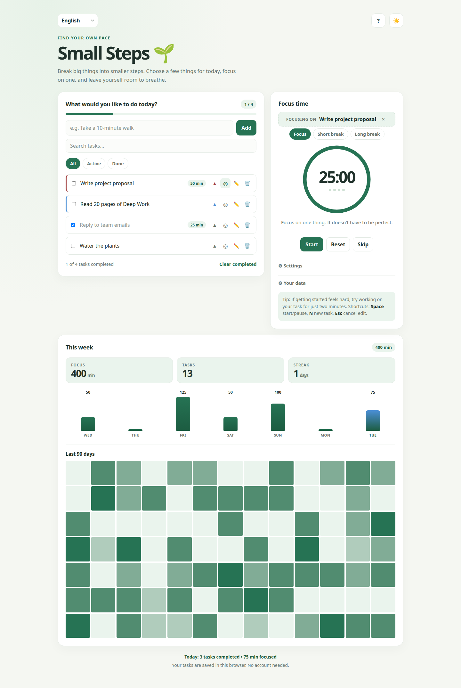

# 🌱 Small Steps

<div align="center">

**Sakin, çevrimdışı çalışan bir odak çalışma alanı: görev listesi + Pomodoro + ilerleme geçmişi.**
Sıfır bağımlılık · 12 dil · Kurulum yapılabilen PWA · Verilerin tarayıcından hiç çıkmaz

<br/>

[](../../releases)
[](../../actions)
[](#-pwa-kurulumu)
[](#-diller)
[](./LICENSE)
[](#-proje-yapısı)

<br/>

[](https://firatnexus.github.io/Small-Steps-/)

<br/>

<sub>[English version](./README.en.md)</sub>

</div>

---

## 📸 Ekran Görüntüleri

<div align="center">

| Masaüstü | Mobil |
|:---:|:---:|
|  |  |

</div>

---

## ✨ Özellikler

### 📝 Görevler

- **Göreve bağlı odak** — ◎ düğmesiyle görev seç; tamamlanan her pomodoro, dakikaları o göreve işleniyor
- **Öncelikler** — yok / düşük / orta / yüksek, renkli şeritle
- **Arama** — anlık, aksan dostu ("ikinci" yaz, "İkinci"yi bulur)
- **Satır içi düzenleme** (çift tıkla), silme geri alma, filtreler, ilerleme çubuğu
- Tamamlanan görevler silinse bile istatistiklerde yaşamaya devam ediyor

### ⏱️ Pomodoro

- Odak / kısa mola / uzun mola döngüsü, süreler ayarlanabilir
- **Doğru kredi:** oturum hangi gün ve hangi süreyle başladıysa ona yazılır — oturum ortasında ayar değişse ya da gece yarısı geçilse istatistik bozulmaz
- Otomatik mola başlatma, sesli çan, masaüstü bildirimleri

### 📊 İlerleme

- Haftalık odak grafiği, seri sayacı, görev ve odak toplamları
- **90 günlük GitHub tarzı ısı haritası**
- Görev başına odak toplamları

### 💾 Veri

- **JSON dışa/içe aktarma** — görevler, ayarlar, geçmiş, tema ve dil dahil tam yedek
- Her şey `localStorage`'da kalır — hesap yok, sunucu yok, izleme yok

### 🎨 Arayüz

- 4 tema: açık, koyu, sepya, yüksek kontrast
- Tam RTL desteği (Arapça) ve 12 dil
- Klavye kısayolları (`?` kılavuzu gösterir), ekran okuyucu dostu

---

## 🚀 Kullanım

### 🌐 Çevrimiçi Dene

**[firatnexus.github.io/Small-Steps-](https://firatnexus.github.io/Small-Steps-/)** — kurulum yok, kayıt yok.

### 💻 Yerel

```bash
git clone https://github.com/firatnexus/Small-Steps-.git
cd Small-Steps-
# macOS
open index.html
# Linux
xdg-open index.html
# Windows
start index.html
```

Service worker / PWA kurulumu için sunucu üzerinden aç:

```bash
npx serve .
```

### 📱 PWA Kurulumu

- **Android / Chrome / Edge:** kurulum bandı veya ⋮ menüsü → *Uygulamayı yükle*
- **iOS Safari:** Paylaş → *Ana Ekrana Ekle*
- Kurulduktan sonra tamamen çevrimdışı çalışır

### ⌨️ Klavye Kısayolları

| Tuş | İşlem |
|---|---|
| `Space` | Zamanlayıcıyı başlat / duraklat |
| `N` | Yeni görev alanına odaklan |
| `?` | Kısayol kılavuzu |
| `Esc` | Pencereleri kapat / düzenlemeyi iptal et |
| çift tık | Görevi düzenle |

---

## 🌍 Diller

English, Türkçe, Español, Français, Deutsch, Português, Italiano, हिन्दी, العربية, 中文, 日本語, Русçe — anahtar-parite test paketiyle (`test.html`) ve CI denetimiyle (`tools/check-translations.js`) korunuyor.

---

## 🏗️ Mimari

```
index.html        — yapı
style.css         — temalar + yerleşim (4 tema, RTL, duyarlı)
app.js            — durum, görevler, zamanlayıcı, istatistik, yedekleme (IIFE, framework yok)
translations.js   — i18n motoru + 12 sözlük
sw.js             — service worker (varlıklar önbellek-öncelikli, HTML ağ-öncelikli)
manifest.json     — PWA manifesti
test.html         — tarayıcı test paketi (i18n bütünlüğü)
tools/            — CI betikleri
```

- **Sıfır bağımlılık** — vanilla HTML/CSS/JS, derleme adımı yok
- **Durum** `localStorage`'da: `small-steps-v2` (görevler, ayarlar, istatistikler) ve `small-steps-history` (günlük odak/tamamlama günlüğü, 90 gün saklanır)
- **Zamanlayıcı** duvar saatini (`endAt`) kullanır; arka planda kısıtlansa da sapmaz

---

## 🛠️ Özelleştirme

### ⏱️ Varsayılan Süreler

`app.js` içinde `DEFAULT_SETTINGS`:

```js
const DEFAULT_SETTINGS = {
  focus: 25, short: 5, long: 15, longEvery: 4,
  autoStart: false, sound: true
};
```

### 🎨 Renk Paleti

`style.css` içinde tema başına CSS özel değişkenleri (`--green`, `--break`, `--bg`, …). Tek yerden değiştir, tüm temalar güncellensin.

### 🌍 Dil Ekleme

1. `translations.js` içindeki `en:` bloğunu kopyala, değerleri çevir (`{yer tutucular}` aynen kalsın)
2. Dil kodunu hem sözlüğe hem `test.html` içindeki beklenen listeye ekle
3. `test.html`'i aç — anahtar-parite testi eksik bırakmadığını doğrular

---

## 💾 Veri Depolama

| Anahtar | İçerik |
|---|---|
| `small-steps-v2` | görevler, ayarlar, filtre, odak görevi, günlük istatistik |
| `small-steps-history` | `{ "YYYY-AA-GG": { focus, done } }`, son 90 gün |
| `small-steps-theme` | seçili tema |
| `small-steps-language` | seçili dil |

Örnek görev kaydı:

```json
{
  "id": "mvgjg40d-9o4em0",
  "text": "Write project proposal",
  "done": false,
  "createdAt": 1792491000000,
  "doneAt": null,
  "priority": 3,
  "focus": 50
}
```

**Ayarlar → Verilerin → Yedek al** ile tarayıcılar ve cihazlar arasında taşıyabileceğin tam JSON yedeği oluştur.

---

## 🧪 Test

```bash
node tools/check-translations.js   # i18n anahtar/yer tutucu paritesi (CI'da da çalışır)
```

Ardından tam paket için (dil değiştirme, RTL, anahtar paritesi, yer tutucu bütünlüğü) tarayıcıda `test.html` dosyasını aç.

---

## 🌐 Tarayıcı Desteği

`localStorage` ve flexbox/grid destekleyen tüm modern tarayıcılar (Chrome, Firefox, Safari, Edge — masaüstü ve mobil). Service worker özellikleri HTTPS veya localhost gerektirir.

---

## 🤝 Katkıda Bulunma

Sorunlar ve PR'lar hoş karşılanır — bkz. [CONTRIBUTING.md](./CONTRIBUTING.md). Bağımlılıksız kalsın: bir özellik framework gerektiriyorsa, muhtemelen buraya ait değildir.

## 📜 Lisans

[MIT](./LICENSE) — istediğini yap, atıf memnuniyetle karşılanır.
